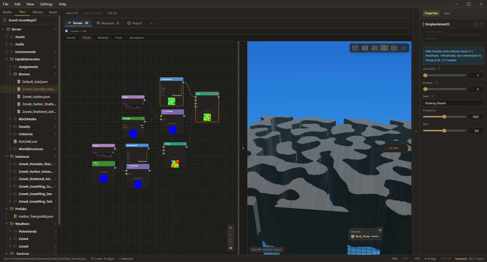

  

  <strong>Developer, photographer, and systems builder working across creative tools, web platforms, local AI, and procedural systems.</strong>

  I build practical software for storytelling, workflow automation, world generation, publishing, and user-centered tools.

  
  
  
  
  

---

## About

I'm Caleb McCartney, a developer and professional photographer based in Pennsylvania.

My work sits at the intersection of **software, storytelling, design, and systems thinking**. I build tools that are practical, readable, and useful in real workflows.

**Current focus:**

- Folio, an iOS-style launcher for Android foldables
- Apature, a keyboard-first culling and delivery tool for photojournalists
- Abridgd, a calm local-news reader for Pittsburgh
- Procedural world generation tools for Hytale
- Editorial and documentary photography

---

## Featured Projects

### TerraNova

A terrain generation studio for the Hytale ecosystem, focused on worldgen editing, biome design, terrain previewing, and creator tooling.

  

  
  
  
  

**Links** — [Download](https://github.com/McCal-Codes/TerraNova/releases) · [Repo](https://github.com/McCal-Codes/TerraNova) · [TerraNova Lab](https://github.com/McCal-Codes/terranova-lab) (online top-down visualizer)

---

### Folio

A clean, iPhone-style Home Screen for Android foldables like the Galaxy Z Fold, with jailbreak-inspired tweaks. Free, open source, no root. Tweaks, themes and layouts are published as signed sources, and Keyd is a companion keyboard.

  
  
  
  

**Links** — [Repo](https://github.com/McCal-Codes/folio) · [Keyd keyboard](https://github.com/McCal-Codes/folio-keyd) · [Tweaks](https://github.com/McCal-Codes/folio-tweaks) · [Source template](https://github.com/McCal-Codes/folio-source-template)

---

### Apature

Keyboard-first contact sheet, culling, captions, export, and delivery for photojournalists. The Photo Mechanic loop, rebuilt in Rust for macOS. Free and open source.

  
  
  
  

**Links** — [Repo](https://github.com/McCal-Codes/apature)

---

### Abridgd

A calm, local-first news reader for Pittsburgh, built to make local news feel finite, readable, and worth returning to.

  
  
  
  

**Links** — [App Releases](https://github.com/McCal-Codes/abridgd/releases) · [Repo](https://github.com/McCal-Codes/abridgd) · [Site](https://github.com/McCal-Codes/abridgd-site)

---

### McCal Media

A custom web platform for photography, editorial work, podcasting, and media projects.

  
  
  

**Links** — [Website](https://mcc-cal.com)

---

### More

- [Void Ledger](https://github.com/McCal-Codes/void-ledger): local-first Warframe Baro Ki'Teer planning app for Windows
- [Ferret](https://github.com/McCal-Codes/Ferret): local-first AI agent system for coding and automation
- [Claude Code system prompts research](https://github.com/McCal-Codes/claude-code-system-prompts): how agentic coding assistants work

---

## Tech Stack

  

---

## Photography

I work as a photojournalist, event photographer, and visual storyteller.

**Published in:** The New York Post · Pittsburgh Magazine · PublicSource · Union Progress · Technical.ly · TribLive

---

## GitHub

  
  

  
  

  

---

## Contact

  
  

  

